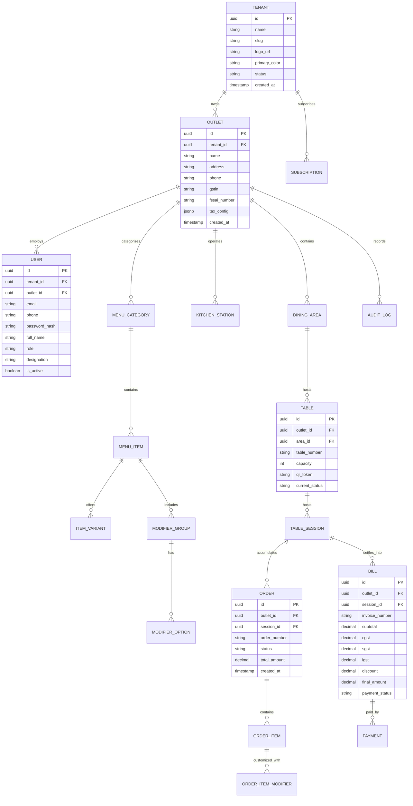

# ServeFlow — Database Schema & Data Modeling

## 1. Relational Entity Relationship Model

---

## 2. Core PostgreSQL Tables & Data Types

### 2.1 Multi-Tenant Core
- `tenants`: Primary tenant account record (`id`, `name`, `slug`, `branding_json`, `status`, `created_at`).
- `outlets`: Individual restaurant branches (`id`, `tenant_id`, `name`, `gstin`, `fssai_number`, `tax_configuration`, `created_at`).
- `subscriptions`: Tenant billing plan (`id`, `tenant_id`, `plan_tier`, `starts_at`, `expires_at`, `status`).

### 2.2 Users & Access Control
- `users`: Staff and administrator profiles (`id`, `tenant_id`, `outlet_id`, `email`, `phone`, `password_hash`, `role`, `designation`, `is_active`).
- `custom_roles`: Optional user-defined RBAC roles (`id`, `tenant_id`, `name`, `permissions_array`).

### 2.3 Operations & Floor Layout
- `dining_areas`: Physical restaurant areas (`id`, `outlet_id`, `name`, `floor_number`).
- `tables`: Dining tables (`id`, `outlet_id`, `area_id`, `table_number`, `capacity`, `qr_token`, `qr_version`, `status`).
- `kitchen_stations`: Food prep stations (`id`, `outlet_id`, `name`, `printer_ip`, `is_active`).

### 2.4 Menu & Pricing Catalog
- `menu_categories`: Categories (`id`, `outlet_id`, `name`, `sort_order`, `is_active`).
- `menu_items`: Food and beverage items (`id`, `category_id`, `kitchen_station_id`, `name`, `description`, `base_price`, `dietary_type`, `is_available`, `image_url`).
- `item_variants`: Size and portion options (`id`, `item_id`, `name`, `price_delta`).
- `modifier_groups`: Customization groups (`id`, `outlet_id`, `name`, `min_selection`, `max_selection`).
- `modifier_options`: Individual add-ons (`id`, `group_id`, `name`, `price`).

### 2.5 Orders & Kitchen Operations
- `table_sessions`: Active dining sessions (`id`, `table_id`, `opened_at`, `closed_at`, `guest_count`, `session_token`, `status`).
- `orders`: Kitchen order tickets (`id`, `session_id`, `outlet_id`, `order_number`, `order_type`, `status`, `placed_by_user_id`).
- `order_items`: Line items (`id`, `order_id`, `item_id`, `variant_id`, `quantity`, `unit_price`, `status`, `kitchen_station_id`, `special_instructions`).
- `order_item_modifiers`: Selected modifiers (`id`, `order_item_id`, `modifier_option_id`, `unit_price`).

### 2.6 Billing, Tax & Payments
- `bills`: Customer invoices (`id`, `session_id`, `outlet_id`, `invoice_number`, `subtotal`, `tax_details_json`, `discount_amount`, `service_charge`, `round_off`, `grand_total`, `settlement_status`).
- `payments`: Financial transactions (`id`, `bill_id`, `amount`, `payment_method`, `transaction_ref`, `gateway_order_id`, `gateway_payment_id`, `status`, `verified_at`).

### 2.7 Audit & Security
- `audit_logs`: Immutable action trail (`id`, `tenant_id`, `outlet_id`, `user_id`, `action`, `entity_type`, `entity_id`, `payload_before`, `payload_after`, `ip_address`, `created_at`).
