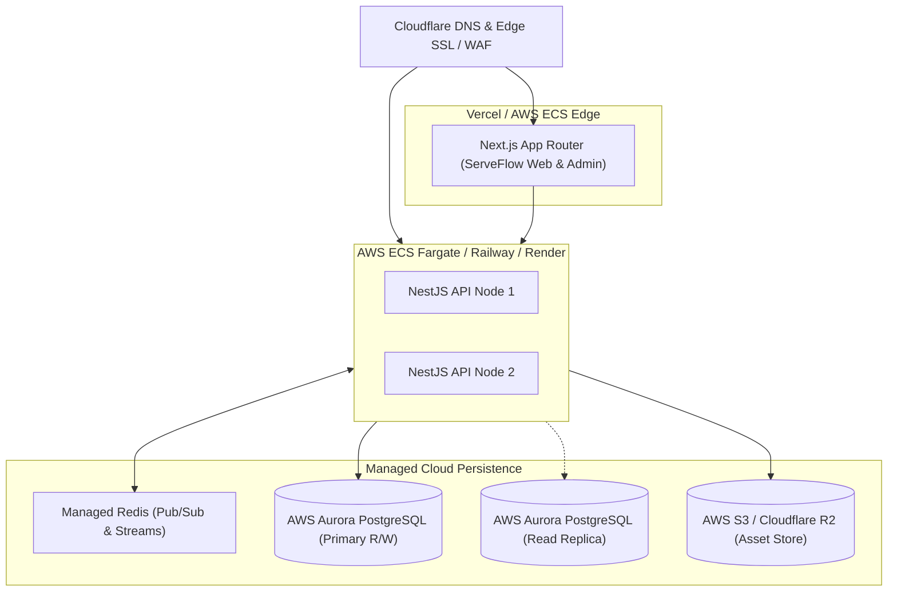

# ServeFlow — Deployment, Infrastructure & CI/CD Strategy

## 1. Production Topology & Cloud Architecture

---

## 2. Environment Strategy

| Environment | Branch | Purpose | Infrastructure |
| :--- | :--- | :--- | :--- |
| **Development** | Local | Developer workspace | Local Docker Compose (Postgres, Redis, MinIO) |
| **Staging** | `develop` | Integration testing & QA | Cloud preview cluster, sanitized seed data |
| **Production** | `main` | Commercial live operations | Multi-AZ AWS / Cloudflare high-availability cluster |

---

## 3. Continuous Delivery Pipeline (GitHub Actions)

1. **Lint & Typecheck**: Parallel execution across monorepo workspaces.
2. **Automated Testing**: Vitest and integration tests executed against ephemeral Postgres service.
3. **Database Migration**: Safe execution of `prisma migrate deploy` with pre-deployment schema compatibility checks.
4. **Container Build & Push**: Multi-stage Docker images pushed to Amazon ECR.
5. **Zero-Downtime Rolling Deployment**: Health-checked rollout on AWS ECS / Kubernetes.
