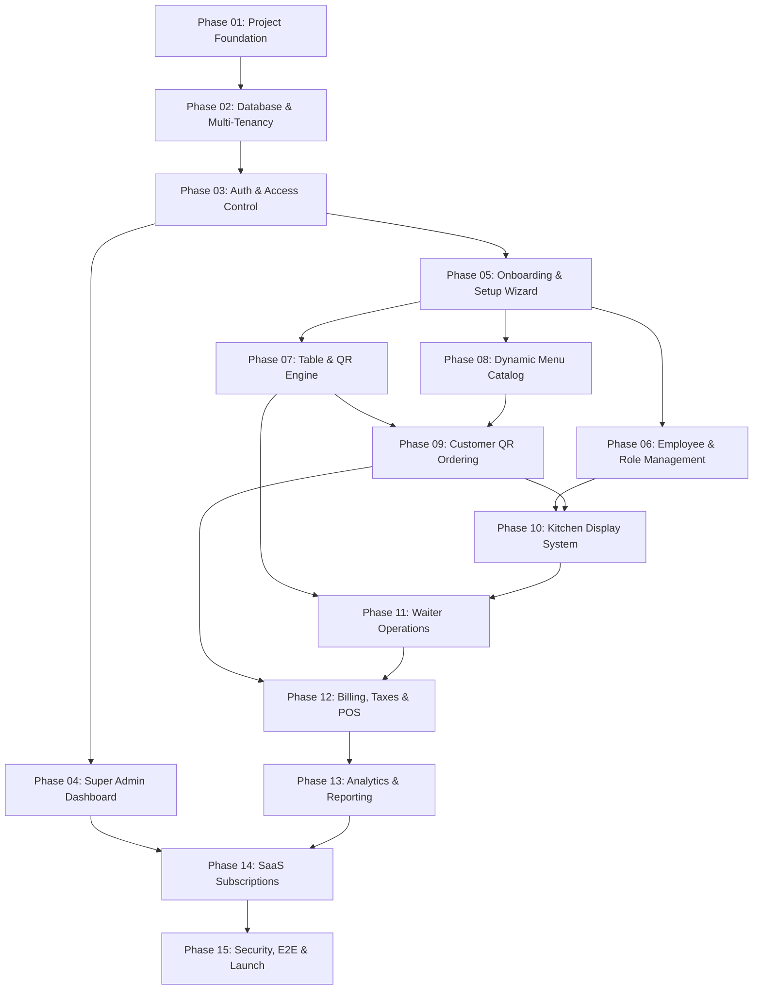

# ServeFlow — 15-Phase Development Roadmap & Dependencies

## 1. Implementation Phases Overview

| Phase | Title | Focus Area |
| :--- | :--- | :--- |
| **PHASE 01** | Project Foundation & Documentation | Monorepo scaffolding, Turborepo, TypeScript, ESLint, Tailwind |
| **PHASE 02** | Database & Multi-Tenant Architecture | PostgreSQL, Prisma ORM, RLS policies, seeders, schema models |
| **PHASE 03** | Authentication & Access Control | JWT auth, session management, RBAC guards, password security |
| **PHASE 04** | Super Admin Dashboard | Platform control plane, tenant provisioning, system telemetry |
| **PHASE 05** | Restaurant Onboarding & Setup Wizard | Outlet setup, brand customization, tax rules, business profile |
| **PHASE 06** | Employee & Role Management | Staff accounts, designations, kitchen station routing assignments |
| **PHASE 07** | Table & QR Management | Visual dining areas, tables, dynamic cryptographic QR generator |
| **PHASE 08** | Dynamic Menu Management | Categories, items, variants, modifier groups, instant 86-list |
| **PHASE 09** | Customer QR Ordering Experience | Mobile-first guest web client, cart, modifiers, order submission |
| **PHASE 10** | Kitchen Display & Order Management | Real-time KDS, ticket aging, station filtering, Socket.IO updates |
| **PHASE 11** | Waiter & Restaurant Operations | Floor companion, live table grid, waiter order-taking, call alerts |
| **PHASE 12** | Billing, Taxes & Payment Management | Dual GST engine, split bills, Razorpay, dynamic UPI QR, thermal POS |
| **PHASE 13** | Analytics & Business Intelligence | Daily sales reports, menu engineering (stars/dogs), outlet metrics |
| **PHASE 14** | SaaS Subscriptions & Customization Engine | Tiered billing plans, feature gating, tenant limits, white-labeling |
| **PHASE 15** | Security, Testing & Production Launch | Security audit, end-to-end Playwright tests, CI/CD, production launch |

---

## 2. Phase Dependency Graph

