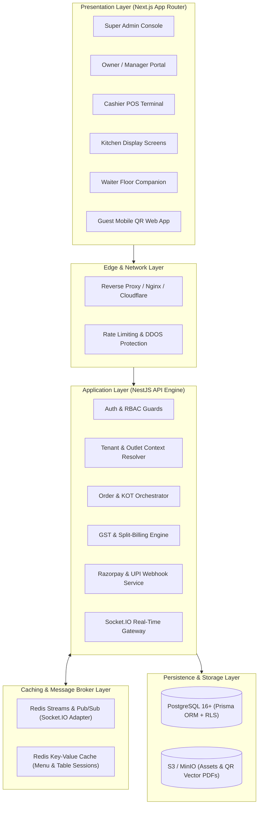

# ServeFlow — System Architecture & Technical Blueprint

## 1. Monorepo & Directory Blueprint

ServeFlow uses a unified Turborepo monorepo structure separating the presentation layer, the API backend, and shared TypeScript libraries.

```
serveflow/
├── apps/
│   ├── web/                     # Next.js 14+ App Router frontend application
│   │   ├── app/
│   │   │   ├── (auth)/          # Authentication routes (login, forgot-password)
│   │   │   ├── (super-admin)/   # Super Admin dashboard routes
│   │   │   ├── (dashboard)/     # Restaurant Owner & Manager portal
│   │   │   ├── (pos)/           # Cashier & POS terminal
│   │   │   ├── (kds)/           # Kitchen Display System
│   │   │   ├── (waiter)/        # Waiter floor companion interface
│   │   │   └── (customer)/      # Guest QR self-ordering experience (table-scoped)
│   │   ├── components/          # Reusable UI components (shadcn/ui + custom domain)
│   │   ├── hooks/               # Custom React hooks (real-time sockets, query hooks)
│   │   └── lib/                 # Client utilities, API fetchers
│   └── api/                     # NestJS backend application
│       ├── src/
│       │   ├── common/          # Guards, interceptors, decorators, filters
│       │   ├── database/        # Prisma service, RLS context interceptor
│       │   ├── modules/         # Modular feature domains:
│       │   │   ├── auth/        # JWT auth, passwords, session tokens
│       │   │   ├── tenants/     # Tenant lifecycle, branding, domains
│       │   │   ├── outlets/     # Outlets, stations, sections, tables
│       │   │   ├── users/       # Staff accounts, roles, permissions
│       │   │   ├── menu/        # Categories, items, modifiers, 86-list
│       │   │   ├── qr/          # QR generation, cryptographic signing, verification
│       │   │   ├── orders/      # Order placement, KOT generation, status engine
│       │   │   ├── kds/         # KDS routing, station queues, socket gateway
│       │   │   ├── billing/     # GST calculation, invoice generation, split bills
│       │   │   ├── payments/    # Razorpay integration, UPI QR, webhook receiver
│       │   │   ├── analytics/   # Aggregation engine, daily summaries, sales metrics
│       │   │   └── subscriptions/# Plan limits, feature flags, SaaS invoicing
│       │   └── main.ts          # Application bootstrap
├── packages/
│   ├── shared-types/            # Shared DTOs, interfaces, and enums
│   ├── validation/              # Shared Zod validation schemas
│   ├── database/                # Prisma schema, migrations, seeders
│   └── ui-kit/                  # Shared UI primitives, design tokens, icons
├── docs/                        # Engineering blueprints and phase documentation
├── .agents/                     # AI agent rules and workflows
├── turbo.json                   # Turborepo task pipeline configuration
├── package.json                 # Monorepo root workspace configuration
└── .env.example                 # Environment variables specification
```

---

## 2. High-Level Architecture Diagram



---

## 3. Communication Protocols

| Channel | Protocol | Use Case |
| :--- | :--- | :--- |
| **REST API** | HTTPS / JSON | CRUD operations, catalog management, authentication, reports |
| **WebSocket** | WSS / Socket.IO | Instant order alerts to KDS, live table state sync to POS, waiter call alerts |
| **Webhooks** | HTTPS POST | Asynchronous Razorpay payment confirmations, WhatsApp delivery receipts |
| **File I/O** | S3 API / Pre-signed URLs | Secure direct upload of menu item images and restaurant logos |

---

## 4. Scalability & Resilience Design

1. **Stateless API Tier**: The NestJS application is entirely stateless. Authentication relies on cryptographically signed JWTs. Real-time WebSocket sessions scale horizontally across multiple instances using the Redis Socket.IO adapter.
2. **Database Optimization**:
   - Connection pooling managed via Prisma client connection limits and PgBouncer.
   - Read/write separation ready for high-volume analytics queries using read-replicas.
   - Comprehensive composite indexing on all tenant and status query paths (e.g., `[tenantId, outletId, status]`).
3. **Optimistic Concurrency Control**: Table sessions and bill items use integer versioning to detect and prevent conflicting simultaneous modifications from multiple staff members or customers.
