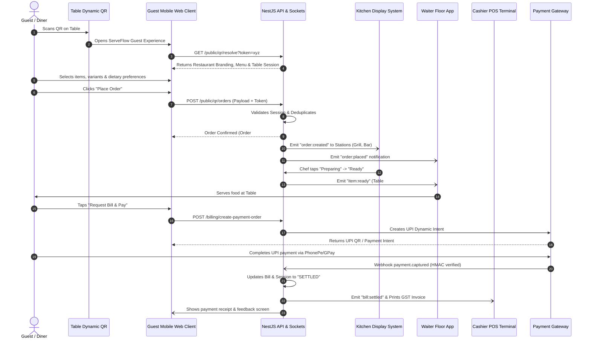

# ServeFlow — End-to-End User Flows

---

## 2. Key Operational Flows

### Flow 1: Table Onboarding & Dynamic QR Rotation
1. Restaurant Manager logs into Dashboard -> Tables & Sections.
2. Creates Table "T-12" (Capacity: 4, Section: "Terrace").
3. System generates a cryptographically signed QR token (`tenantId.outletId.tableId.hmac`).
4. Manager downloads the vector PDF or sends it to the label printer.
5. If the QR code is copied or vandalized, Manager clicks "Revoke & Regenerate QR". The old token is instantly blacklisted in Redis and DB, and a new QR code is activated.

### Flow 2: Split Billing & Settlement Flow
1. Cashier opens Table Session #402 with 4 dining guests.
2. Guests request a split: 2 guests paying cash, 2 guests paying UPI.
3. Cashier selects "Split Bill" -> "By Custom Amount" or "By Selected Items".
4. Cashier records Cash settlement for Part 1 (Receipt printed).
5. Cashier displays Dynamic BharatQR on customer-facing display for Part 2.
6. Customer scans with GPay; webhook confirms capture; POS prints settled tax invoice.
